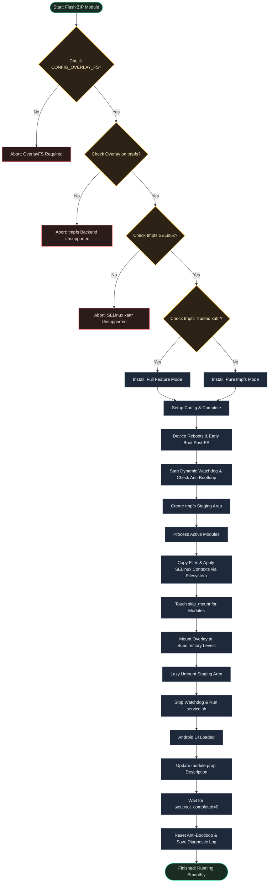

[English](README.md) | [Bahasa Indonesia](README.id.md)

# NanoMount

**A high-performance, ultra-lightweight OverlayFS mount engine for Android.**


## Overview

NanoMount is an ultra-lightweight root module that replaces heavy, traditional bind mounts with a unified, high-performance OverlayFS system. It loads active module files into a temporary RAM staging area (`tmpfs`) and mounts them cleanly over partitions like `/system`, `/vendor`, and `/product` in a single, seamless step.

---

## Why Use NanoMount?

- **Stealth by Design**: Mounts files under hidden paths (like `/dev/my_preload`), bypassing root detection and security checks.
- **Pure RAM Staging**: Operates entirely in memory (`tmpfs`). Zero disk overhead, no ext4 loop images, and no storage wear.
- **Sourced Shell Safety**: Fully refactored to execute safely when sourced as `metamount.sh` in KernelSU and APatch.
- **Optimized & Dynamic**: Features a manager-aware watchdog (8s on KSU/APatch, 35s on Magisk) and eliminates subshell pipelines for faster boot times.
- **Persistent Diagnostics**: Saves a clean boot diagnostic summary at `/data/adb/nanomount/last_boot.log`.

---

## Requirements

| Requirement | Details |
|-------------|---------|
| Android | 10.0+ (API 29+) |
| Kernel | `CONFIG_OVERLAY_FS=y`, `tmpfs` as valid OverlayFS lower filesystem, & `tmpfs` `security.selinux` xattr support |
| Root | Magisk, KernelSU, or APatch |

---

## Installation & File Structure

1. Install the ZIP file via your root manager's **Modules** tab.
2. **Reboot** your device to activate.
3. Configure settings at: `/data/adb/nanomount/config.sh`

### File Structure

```text
NanoMount/
├── META-INF/
│   └── com/
│       └── google/
│           └── android/
│               ├── update-binary
│               └── updater-script
├── config.sh           # user-configurable settings
├── customize.sh        # install-time compatibility & metamodule setup
├── module.prop         # module metadata properties
├── post-fs-data.sh     # core subdirectory mount engine (renamed to metamount.sh on KSU/APatch)
├── service.sh          # status description updater & diagnostic logger
├── boot-completed.sh  # boot completion watchdog reset (KSU/APatch)
└── uninstall.sh        # cleanup script
```

---

## Limitations & Advanced Configuration

### Known Limitations
NanoMount mounts modifications at the first-level subdirectory level (e.g., `/system/bin`, `/system/etc`). If another early-boot script or tool has already mounted a filesystem directly over one of these subdirectories before NanoMount runs, the duplicate mount will be skipped for safety. Any modifications inside that specific subdirectory will not be applied (logged to `/dev/kmsg`).

### Conflict Resolution
If multiple modules modify the same file (e.g., `/system/etc/hosts`), the last processed file wins in the `tmpfs` staging area:
*   **Auto Mode**: Processed **alphabetically** by module folder name. The last folder alphabetically wins.
*   **Manual Mode**: Processed **top-to-bottom** as listed in `/data/adb/nanomount/modules.txt`. The bottom-most module wins.

### Excluding Modules
To prevent NanoMount from processing a specific module (e.g., if it is incompatible or manages its own mounting):
*   Create an empty file named `skip_nanomount` inside that module's folder:
    `/data/adb/modules/<module-id>/skip_nanomount`
*   NanoMount will ignore this module and let your root manager handle it normally.

---

## How It Works



---

## Developer, Credits & License

- **Developer**: [dyokism](https://github.com/dyokism)
- **Special Thanks**: [bnsmb](https://github.com/bnsmb) for finding the kernel compatibility gap.
- **License**: MIT
